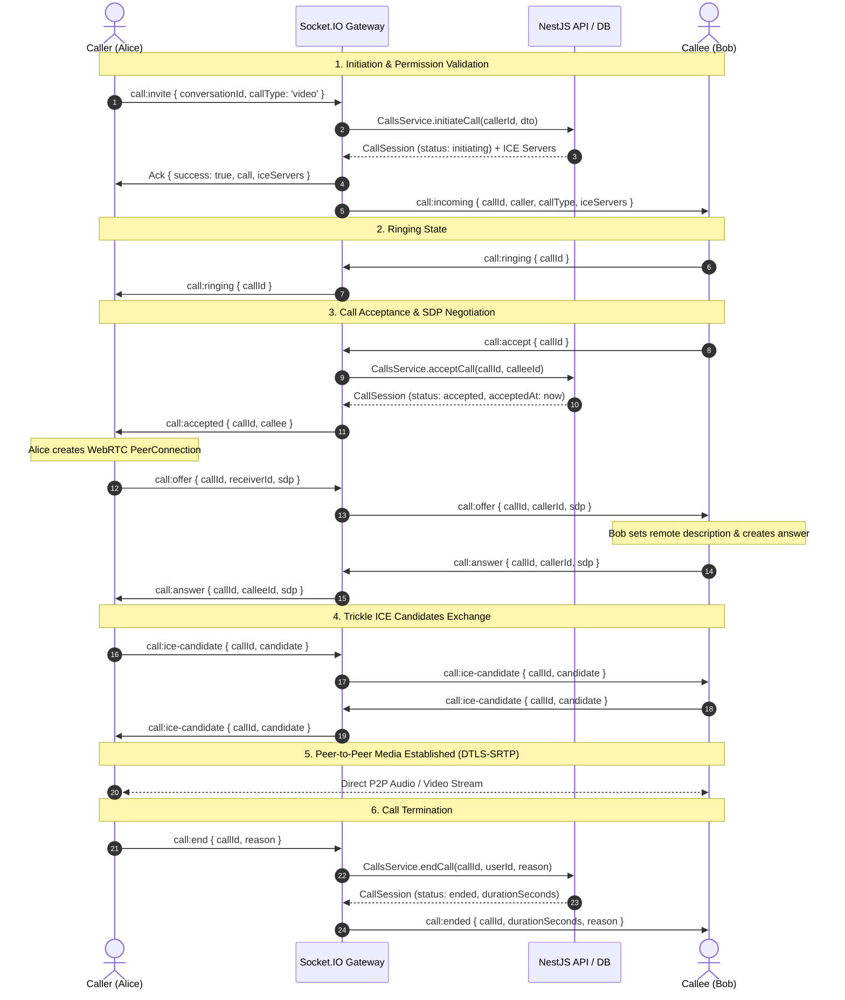

# CHITHI — WebRTC Signaling & Media Architecture

## 1. Sequence Diagram: One-to-One Call Session



---

## 2. Signaling Event Catalog

| Event Name | Direction | Payload | Description |
|---|---|---|---|
| `call:invite` | Client -> Server | `{ conversationId, callType }` | Caller requests call session creation |
| `call:incoming` | Server -> Client | `{ callId, conversationId, callType, caller, iceServers }` | Gateway delivers call invitation to callee's personal room |
| `call:ringing` | Client -> Server -> Client | `{ callId }` | Callee informs caller device is actively alerting |
| `call:accept` | Client -> Server | `{ callId }` | Callee accepts incoming call |
| `call:accepted` | Server -> Client | `{ callId, callee }` | Caller receives confirmation that callee answered |
| `call:reject` | Client -> Server -> Client | `{ callId, reason }` | Callee declines or signals busy |
| `call:cancel` | Client -> Server -> Client | `{ callId }` | Caller aborts call before recipient answers |
| `call:offer` | Client -> Server -> Client | `{ callId, receiverId, sdp }` | Relays WebRTC SDP Offer |
| `call:answer` | Client -> Server -> Client | `{ callId, callerId, sdp }` | Relays WebRTC SDP Answer |
| `call:ice-candidate` | Client -> Server -> Client | `{ callId, targetUserId, candidate }` | Relays ICE candidate for NAT traversal |
| `call:end` | Client -> Server -> Client | `{ callId, reason }` | Terminates active call, updates duration in database |
| `call:timeout` | Client / Server | `{ callId }` | Emitted when unacknowledged call reaches timeout limit |
| `call:missed` | Server -> Client | `{ callId, callType }` | Notifies recipient of a missed call |

---

## 3. Database Call State Machine
```
                       +-------------------+
                       |    INITIATING     |
                       +---------+---------+
                                 |
              +------------------+------------------+
              |                                     |
              v                                     v
       +--------------+                      +--------------+
       |   RINGING    |                      |  CANCELLED   |
       +-------+------+                      +--------------+
               |
      +--------+--------+-------------------+
      |                 |                   |
      v                 v                   v
+-----------+     +------------+      +------------+
| ACCEPTED  |     |  REJECTED  |      |   MISSED   |
+-----+-----+     +------------+      +------------+
      |
      +------------------+
      |                  |
      v                  v
+-----------+     +------------+
|   ENDED   |     |   FAILED   |
+-----------+     +------------+
```

---

## 4. NAT Traversal & ICE Connection Lifecycle
1. **Host Candidates**: Direct private LAN IP addresses tested first.
2. **Server Reflexive Candidates (STUN)**: Public IP addresses discovered via STUN queries to `stun.l.google.com:19302`.
3. **Relay Candidates (TURN)**: Relayed packets through Coturn TURN server over UDP or TCP fallback when symmetrical NAT is encountered.
4. **ICE Candidate Trickling**: Candidates are sent immediately as they are gathered, shortening connection establishment from 5-10 seconds to sub-500 milliseconds.
